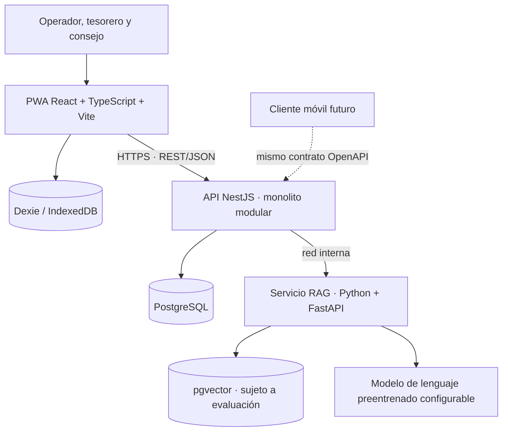

# SIJASS — Sistema Inteligente de Gestión y Monitoreo de Agua para JASS

**Análisis y diseño arquitectónico** · Curso **IS-488 Arquitectura de Software**
Universidad Nacional de San Cristóbal de Huamanga — Escuela Profesional de Ingeniería de Sistemas

**Autor:** Flores Saras, Henry Josue (27220123)

**Docente:** Ing. Lizbeth Jaico Quispe

Ayacucho, Perú — 2026

> **Estado del proyecto:** documentación de arquitectura (diseño propuesto) y un prototipo de dominio en TypeScript. SIJASS no es todavía una aplicación desplegada, no es una solución sanitaria certificada y no incluye IA validada en campo.

---

## Descripción

SIJASS es una solución de software para las **Juntas Administradoras de Servicios de Saneamiento (JASS)** de la región Ayacucho, organizaciones comunales que administran el agua potable en el ámbito rural.

El sistema atiende dos necesidades:

1. **Trazabilidad de las mediciones de cloro residual**, hoy anotadas en cuadernos: quién midió, cuándo, en qué reservorio, con qué método y qué correcciones se hicieron.
2. **Digitalización del control de asociados, cuotas y pagos**, que también se lleva en registros físicos.

Como los reservorios suelen estar en zonas sin cobertura, el registro de mediciones funciona **sin conexión** y se sincroniza después. La inteligencia artificial del MVP es un **asistente documental RAG** que responde preguntas sobre documentos técnicos aprobados, citando sus fuentes.

### Cambio de alcance (octubre de 2026)

La versión anterior proponía estimar el cloro con visión artificial a partir de fotografías del reactivo DPD. Esa capacidad **se retira del MVP** porque no existe un dataset etiquetado ni una referencia instrumental que permita entrenarla y validarla. En su lugar:

- el operador obtiene la lectura con el procedimiento de campo establecido y la **registra manualmente**; la fotografía es evidencia opcional;
- la IA del MVP es un **asistente RAG** con un modelo preentrenado, que cita documento, versión y página, o se abstiene;
- la detección de anomalías, el análisis predictivo y la estimación fotográfica pasan a etapas futuras condicionadas a datos suficientes.

Ver [estrategia de IA sin dataset](docs/06-estrategia-ia/estrategia-ia-sin-dataset.md).

---

## Alcance del MVP

| Capacidad | Modo | Restricción clave |
|---|---|---|
| JASS, reservorios, usuarios y roles | En línea | Autorización por rol y JASS en el servidor |
| Asociados, cuotas, pagos y morosidad | **Solo en línea** | Sin pagos ni conciliación sin conexión |
| Registro manual de mediciones con foto opcional | En línea y sin conexión | El sistema no infiere concentraciones de imágenes |
| Correcciones auditables | En línea y sin conexión | Se conserva el valor original; conflictos explícitos |
| Sincronización de mediciones | Diferida | UUID por operación e idempotencia transaccional |
| Historial, reportes y validaciones determinísticas | En línea | Las advertencias no son dictamen sanitario |
| Asistente documental RAG | **Solo en línea** | Citas verificables, abstención sin evidencia, sin escrituras |

Detalle en [alcance y hoja de ruta](docs/00-alcance-y-roadmap.md).

**Límite sanitario:** SIJASS apoya el registro, la consulta y la revisión humana. No certifica la potabilidad ni genera instrucciones de tratamiento o dosificación química.

---

## Arquitectura objetivo

> **Monolito modular NestJS** con **Clean Architecture** + **PWA React** con registro de mediciones sin conexión + **servicio RAG Python/FastAPI** en línea, comunicados mediante **API REST/JSON** documentada con OpenAPI.



### Stack tecnológico

| Componente | Tecnología | Estado |
|---|---|---|
| Frontend | React + TypeScript + Vite | Diseño propuesto |
| PWA | `vite-plugin-pwa` + Workbox | Diseño propuesto |
| Persistencia local | Dexie + IndexedDB | Diseño propuesto |
| Backend | Node.js + NestJS, monolito modular con Clean Architecture | Diseño propuesto |
| Comunicación | API REST/JSON sobre HTTPS con OpenAPI | Diseño propuesto |
| Base de datos central | PostgreSQL | Diseño propuesto |
| Servicio de IA | Python + FastAPI (asistente RAG) | Diseño propuesto |
| Recuperación documental | PostgreSQL + pgvector | Sujeto a evaluación |
| Modelo de lenguaje | Preentrenado y configurable | Proveedor por decidir |
| Clientes móviles | React Native, Capacitor, Flutter u otra alternativa | Futuro |
| Dominio de referencia | TypeScript con pruebas `node:test` | Prototipo |

### Drivers dominantes

| Driver | Consecuencia arquitectónica |
|---|---|
| **DA01** — Captura sin conexión | PWA con Dexie/IndexedDB, cola local visible y sincronización idempotente |
| **DA02** — Ausencia de dataset DPD | Registro manual; visión artificial solo como investigación futura |
| **DA05** — Equipo pequeño | Monolito modular en lugar de microservicios |
| **DA06** — Varias JASS | Autorización por recurso y aislamiento entre organizaciones |
| **DA10/DA11** — Información confiable e IA segura | RAG con corpus aprobado, citas, abstención y sin escrituras |

---

## Estructura del repositorio

```text
.
├── README.md
├── docs/
│   ├── 00-alcance-y-roadmap.md                  # Alcance MVP, estados, hoja de ruta y deuda técnica
│   ├── 01-analisis-de-sistema/
│   │   ├── 01-actores.md                        # Actores y matriz RBAC
│   │   ├── 02-historias-del-usuario.md          # HU01–HU13
│   │   ├── 03-requisitos-funcionales.md         # RF01–RF15
│   │   ├── 04-atributos-de-calidad.md           # RNF01–RNF10
│   │   ├── 05-restricciones.md                  # RC01–RC14 y marco normativo
│   │   ├── 06-driver-arquitectonicos.md         # DA01–DA12
│   │   ├── 07-decisiones-arquitectonicas.md     # ADR-001–ADR-015
│   │   └── 08-escenarios-atributos-calidad.md   # EC-01–EC-12
│   ├── 02-arquitectura-software/
│   │   ├── arquitectura-inicial.md              # Visión general, stack y despliegue
│   │   ├── componentes-arquitectonicos.md       # Catálogo de componentes
│   │   ├── enfoque-arquitectonico.md            # Clean Architecture pragmática
│   │   └── estilo-arquitectonico.md             # Estilos combinados y fallos
│   ├── 03-diseno-de-software/diseno-interno/
│   │   ├── diseno-interno-de-modulos.md         # Módulos, sincronización, RAG, contratos HTTP
│   │   ├── patrones-de-diseno.md                # Patrones de diseño
│   │   └── principios-de-diseno.md              # Principios SOLID
│   ├── 04-modelo-c4/                            # Niveles 1 a 4 del modelo C4
│   ├── 05-trazabilidad-y-validacion/
│   │   ├── matriz-trazabilidad.md               # HU → RF → RNF → DA → ADR → pruebas
│   │   └── plan-pruebas.md                      # PT01–PT25
│   └── 06-estrategia-ia/
│       └── estrategia-ia-sin-dataset.md         # Asistente RAG y evolución de la IA
└── tecnologia/
    └── siJASS-clean-architecture/               # Prototipo TypeScript de dominio
```

---

## Documentación

| Etapa | Documento | Contenido |
|---|---|---|
| 0 | [Alcance y hoja de ruta](docs/00-alcance-y-roadmap.md) | Estados, MVP, etapas, deuda técnica y decisiones abiertas |
| 1 | [Actores](docs/01-analisis-de-sistema/01-actores.md) | 8 actores y matriz de permisos |
| 2 | [Historias de usuario](docs/01-analisis-de-sistema/02-historias-del-usuario.md) | 13 historias priorizadas con MoSCoW |
| 3 | [Requisitos funcionales](docs/01-analisis-de-sistema/03-requisitos-funcionales.md) | 15 requisitos con criterios verificables |
| 4 | [Atributos de calidad](docs/01-analisis-de-sistema/04-atributos-de-calidad.md) | 10 atributos con medidas propuestas |
| 5 | [Restricciones](docs/01-analisis-de-sistema/05-restricciones.md) | 14 restricciones y marco normativo |
| 6 | [Drivers arquitectónicos](docs/01-analisis-de-sistema/06-driver-arquitectonicos.md) | 12 drivers |
| 7 | [Decisiones arquitectónicas](docs/01-analisis-de-sistema/07-decisiones-arquitectonicas.md) | 15 ADR con contexto, alternativas, consecuencias y estado |
| 8 | [Escenarios de calidad](docs/01-analisis-de-sistema/08-escenarios-atributos-calidad.md) | 12 escenarios evaluables |
| 9 | [Arquitectura inicial](docs/02-arquitectura-software/arquitectura-inicial.md) · [Componentes](docs/02-arquitectura-software/componentes-arquitectonicos.md) · [Enfoque](docs/02-arquitectura-software/enfoque-arquitectonico.md) · [Estilo](docs/02-arquitectura-software/estilo-arquitectonico.md) | Arquitectura de software |
| 10 | [Diseño interno](docs/03-diseno-de-software/diseno-interno/diseno-interno-de-modulos.md) · [Patrones](docs/03-diseno-de-software/diseno-interno/patrones-de-diseno.md) · [SOLID](docs/03-diseno-de-software/diseno-interno/principios-de-diseno.md) | Diseño de software |
| 11 | [C4 nivel 1](docs/04-modelo-c4/Nivel1-Diagrama-de-Contexto-del-Sistema.md) · [nivel 2](docs/04-modelo-c4/Nivel2-Diagrama-de-Contenedores.md) · [nivel 3](docs/04-modelo-c4/Nivel3-Diagrama-de-Componentes.md) · [nivel 4](docs/04-modelo-c4/Nivel4-Diagrama-de-Codigo.md) | Modelo C4 |
| 12 | [Matriz de trazabilidad](docs/05-trazabilidad-y-validacion/matriz-trazabilidad.md) · [Plan de pruebas](docs/05-trazabilidad-y-validacion/plan-pruebas.md) | Trazabilidad y validación |
| 13 | [Estrategia de IA](docs/06-estrategia-ia/estrategia-ia-sin-dataset.md) | RAG sin dataset propio |
| — | [Prototipo](tecnologia/siJASS-clean-architecture/README.md) | Código de dominio existente |

---

## Estado de implementación

| Artefacto | Estado |
|---|---|
| Requisitos, decisiones y diagramas | Diseño propuesto; pendiente de validación con usuarios reales |
| Entidad `Medicion`, caso de uso y repositorios en memoria | Prototipo con el modelo de datos anterior |
| Pruebas del prototipo | 5 pruebas unitarias; la compilación falla en instalación limpia por falta de `@types/node` (verificado el 2026-10-28) |
| PWA, API NestJS, PostgreSQL, sincronización y asistente RAG | No implementados |

La documentación se actualizó antes que el código: el prototipo **no satisface aún** los requisitos del MVP. Ver la [deuda técnica](docs/00-alcance-y-roadmap.md#6-deuda-técnica-conocida) y el [plan de pruebas](docs/05-trazabilidad-y-validacion/plan-pruebas.md).

---

## Cómo ver los diagramas

Los diagramas están escritos en **Mermaid** dentro de los archivos `.md` y GitHub los renderiza automáticamente. También pueden visualizarse en [mermaid.live](https://mermaid.live).

---

## Referencias

- Bass, L., Clements, P., & Kazman, R. (2021). *Software Architecture in Practice* (4th ed.). Addison-Wesley.
- Brown, S. (2018). *The C4 model for visualising software architecture*. https://c4model.com
- Martin, R. C. (2017). *Clean Architecture: A Craftsman's Guide to Software Structure and Design*. Prentice Hall.
- Nygard, M. (2011). *Documenting architecture decisions*. https://cognitect.com/blog/2011/11/15/documenting-architecture-decisions
- Lewis, P. et al. (2020). *Retrieval-Augmented Generation for Knowledge-Intensive NLP Tasks*. NeurIPS 2020. https://arxiv.org/abs/2005.11401
- OWASP Foundation. (2024). *OWASP Top 10 for LLM Applications 2025*. https://genai.owasp.org/resource/owasp-top-10-for-llm-applications-2025/
- MDN Web Docs. *Storage quotas and eviction criteria*. https://developer.mozilla.org/en-US/docs/Web/API/Storage_API/Storage_quotas_and_eviction_criteria
- Ministerio de Salud. (2010). *D. S. N.° 031-2010-SA — Reglamento de la Calidad del Agua para Consumo Humano*. https://www.gob.pe/institucion/minsa/normas-legales/244805-031-2010-sa
- Ministerio de Salud. (2026). *R. M. N.° 568-2026-MINSA* — publicación del **proyecto** de un nuevo reglamento de calidad del agua (no es una norma aprobada). https://www.gob.pe/institucion/minsa/normas-legales/8274822-568-2026-minsa
- Ministerio de Justicia y Derechos Humanos. (2024). *D. S. N.° 016-2024-JUS — Reglamento de la Ley N.° 29733, Ley de Protección de Datos Personales*. https://www.gob.pe/institucion/smv/normas-legales/6426760-016-2024-jus
