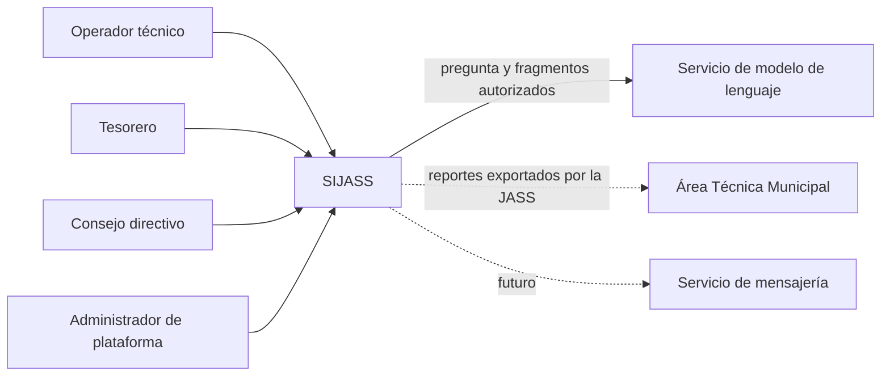

# 01. Actores e interesados — SIJASS

**Estado:** diseño propuesto; los roles y permisos deben validarse con las JASS piloto.

## 1. Actores

| Actor | Tipo | Objetivo | Capacidades en el MVP | Límites |
|---|---|---|---|---|
| Operador técnico | Primario | Registrar y consultar mediciones de cloro residual | Registrar lecturas manuales con evidencia opcional, operar sin conexión, corregir sus mediciones con auditoría, consultar historial y asistente documental | No administra pagos, usuarios ni documentos |
| Tesorero | Primario | Administrar padrón, cuotas y pagos | Gestionar asociados, cuotas y pagos **en línea**, consultar morosidad y asistente documental | No modifica mediciones |
| Consejo directivo (administrador de JASS) | Primario | Configurar la organización y supervisar | Gestionar reservorios, usuarios y roles de su JASS; consultar historiales, auditoría y reportes; administrar documentos privados de su JASS | No puede alterar el historial de auditoría ni acceder a otras JASS |
| Administrador de plataforma | Secundario | Operar la plataforma de forma centralizada | Dar de alta JASS y su primer usuario del consejo; administrar el corpus documental público; soporte técnico | Sin acceso rutinario a datos operativos; todo acceso de soporte queda auditado |
| Área Técnica Municipal (ATM) | Interesado externo | Supervisar la prestación del servicio | Recibir reportes que la JASS decida compartir fuera del sistema | Sin cuenta ni acceso directo en el MVP |
| Asociados | Interesados | Transparencia sobre cuotas y calidad del agua | Ninguna en el MVP | Acceso directo considerado **futuro** |
| Servicio de modelo de lenguaje (LLM) | Sistema externo | Redactar respuestas a partir de fragmentos recuperados | Recibe únicamente pregunta y contexto autorizado y minimizado | No es usuario; no escribe datos ni toma decisiones |
| Servicio de mensajería | Sistema externo | Distribuir notificaciones | Ninguna en el MVP | Integración **futura** (HU11/RF12) |

## 2. Matriz de permisos (RBAC) del MVP

Leyenda: **C** crear · **L** leer · **A** actualizar o corregir · **—** sin permiso. Todos los permisos se limitan a la JASS de la membresía activa del usuario.

| Recurso | Operador | Tesorero | Consejo | Administrador de plataforma |
|---|---|---|---|---|
| JASS (organización) | L | L | L, A | C, L, A |
| Reservorios | L | L | C, L, A | — |
| Usuarios y membresías | — | — | C, L, A | C (primer consejo) |
| Mediciones de cloro | C, L, A (propias) | L | L, A (con motivo) | — |
| Asociados | — | C, L, A | L | — |
| Cuotas y pagos | — | C, L, A (reversa) | L | — |
| Reportes e historial | L (mediciones) | L (cuotas) | L | — |
| Bitácora de auditoría | — | — | L | L (eventos de plataforma) |
| Documentos públicos del corpus | L | L | L | C, L, A |
| Documentos privados de la JASS | L | L | C, L, A | — |
| Asistente RAG | Consultar | Consultar | Consultar | Consultar |

La matriz es una propuesta inicial; los permisos finos (por ejemplo, si el consejo puede corregir mediciones de terceros) se confirmarán con las JASS piloto.

## 3. Reglas transversales

- **Ámbito organizacional (tenant):** cada dato operativo pertenece a una JASS. El backend obtiene la JASS autorizada de la membresía del usuario y la verifica en **cada** recurso; un `jassId` enviado por el cliente nunca concede acceso por sí mismo.
- **Autenticación no es autorización:** un token válido de la JASS A no habilita recursos de la JASS B.
- **Auditoría:** se registra quién creó, corrigió, anuló o consultó recursos sensibles, y los intentos de acceso denegados relevantes.
- **Protección de datos personales:** los datos de asociados, pagos y fotografías se tratan conforme a la Ley N.° 29733 y su reglamento; se aplica minimización y control de acceso.
- **IA:** el asistente ayuda a consultar documentos; **no** registra mediciones, no modifica datos administrativos ni emite decisiones sanitarias.

## 4. Diagrama de contexto de actores

