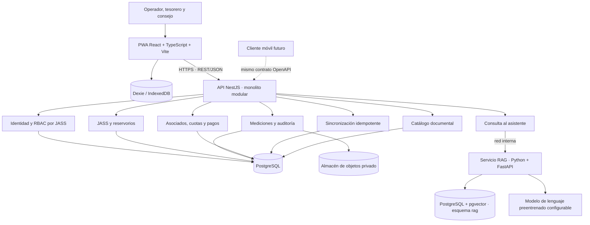
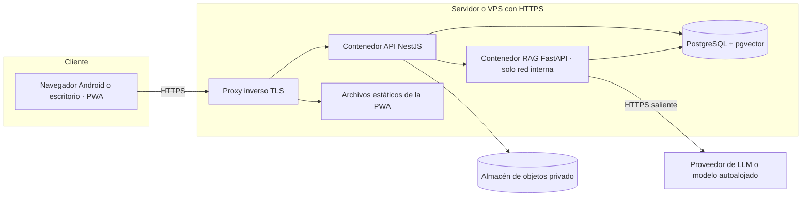

# Arquitectura inicial — SIJASS

**Estado:** diseño propuesto. El repositorio contiene únicamente un prototipo de dominio en TypeScript; ninguno de los contenedores descritos está implementado.

## 1. Visión general

SIJASS se diseña como una **API REST independiente de la interfaz**, concebida como **monolito modular NestJS** con **Clean Architecture**, consumida inicialmente por una **PWA React** capaz de registrar mediciones sin conexión. La IA del MVP es un **asistente documental RAG** en línea, ubicado en un servicio auxiliar Python + FastAPI.

## 2. Pila tecnológica

| Capa | Tecnología | Estado |
|---|---|---|
| Frontend | React + TypeScript + Vite | Diseño propuesto |
| PWA | `vite-plugin-pwa` + Workbox | Diseño propuesto |
| Persistencia local | Dexie sobre IndexedDB | Diseño propuesto |
| Backend | Node.js + NestJS, monolito modular | Diseño propuesto |
| Comunicación | REST/JSON sobre HTTPS, contrato OpenAPI | Diseño propuesto |
| Base de datos | PostgreSQL | Diseño propuesto |
| Servicio de IA | Python + FastAPI | Diseño propuesto |
| Recuperación documental | PostgreSQL + pgvector | Propuesto, sujeto a evaluación (ADR-015) |
| Modelo de lenguaje | Preentrenado, configurable mediante adaptador | Diseño propuesto; proveedor por decidir |
| Clientes móviles | React Native, Capacitor, Flutter u otra alternativa | Futuro |
| Dominio de referencia | TypeScript (entidad, caso de uso, repositorio en memoria) | Prototipo |

## 3. Reglas operativas

1. **Origen de la medición:** la concentración se lee con el procedimiento de campo y se registra manualmente; la fotografía es evidencia opcional, nunca una estimación.
2. **Modos de operación:** mediciones y sus correcciones funcionan sin conexión; pagos, administración y asistente RAG requieren conexión.
3. **Integridad:** el `operationId` y el hash del contenido se validan en la misma transacción que el efecto de negocio.
4. **Seguridad:** la JASS autorizada y los permisos se comprueban en el servidor para cada recurso y documento.
5. **IA:** corpus aprobado, recuperación filtrada por permisos, citas por documento y página, abstención sin evidencia, sin escrituras ni decisiones sanitarias.
6. **Sobriedad:** no se incorporan Redis, colas dedicadas ni microservicios adicionales sin evidencia de necesidad (ADR-009).

## 4. Despliegue sugerido para el piloto

- Respaldos automáticos de PostgreSQL y del almacén de objetos, con prueba periódica de restauración.
- Migraciones versionadas; secretos en variables de entorno, nunca en el repositorio.
- El servicio RAG no se expone a internet; solo la API NestJS lo invoca con credencial de servicio.
- Telemetría sin datos personales ni contenido completo de conversaciones, salvo política aprobada.
- No se promete alta disponibilidad sin presupuesto; se documenta el tiempo de recuperación esperado.

## 5. Riesgos abiertos

| Riesgo | Mitigación prevista |
|---|---|
| Pérdida de datos locales por desalojo de IndexedDB | Solicitud de almacenamiento persistente, avisos de pendientes, sincronización temprana |
| Acceso entre JASS por error de autorización | Filtro obligatorio en repositorios y pruebas negativas automatizadas (PT13) |
| Respuestas del asistente sin sustento o con instrucciones inyectadas | Citas verificadas, abstención, documentos tratados como datos (PT15–PT17) |
| Exposición de datos personales al proveedor de LLM | Minimización del contexto; solo fragmentos documentales |
| Compatibilidad PWA en teléfonos reales | Matriz de dispositivos en el piloto (PT07) |
| Vigencia de normas en el corpus | Versionado y aprobación humana (ADR-010) |

Véanse los [escenarios de calidad](../01-analisis-de-sistema/08-escenarios-atributos-calidad.md) y el [modelo C4](../04-modelo-c4/Nivel2-Diagrama-de-Contenedores.md).
