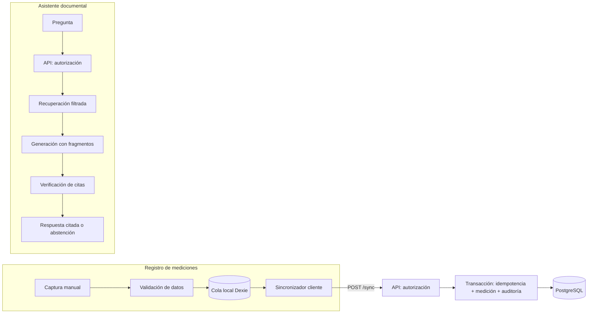

# Componentes arquitectónicos — SIJASS

**Estado:** diseño propuesto; ningún componente está implementado salvo el prototipo de dominio indicado.

## 1. Catálogo

| Componente | Contenedor | Entrada | Salida | Responsabilidad y dependencias | RF |
|---|---|---|---|---|---|
| CapturaMedicionManual | PWA | Valor, unidad, método, fecha, reservorio, foto opcional | Comando de medición | Formulario React; **no infiere cloro de la imagen** | RF06 |
| ValidacionDatos | PWA y API | Comando y reglas versionadas | Errores y advertencias | Reglas determinísticas compartidas; el servidor es la referencia | RF07, RF15 |
| RegistroOffline | PWA | Comando de medición o corrección | Operación con `operationId` y estado local | Dexie/IndexedDB; solicita almacenamiento persistente | RF10 |
| Sincronizador (cliente) | PWA | Operaciones pendientes | Estado por operación | Reintentos con espera exponencial; no borra hasta confirmación | RF10 |
| IdentidadYPermisos | API | Credenciales, sesión | Contexto autorizado (actor, rol, JASS) | JWT, RBAC y membresía | RF01 |
| OrganizacionJass | API | Datos de JASS y reservorios | Catálogos | PostgreSQL | RF02 |
| AsociadosCuotasPagos | API | Padrón, cuotas, pagos en línea | Saldos y comprobantes | Transacciones e idempotencia por pago | RF03, RF04, RF05 |
| MedicionesAuditoria | API | Alta, corrección, anulación, consulta | Historial con revisiones | Transacciones; almacén de objetos para evidencias | RF06–RF08, RF11 |
| SincronizacionServidor | API | Lote de operaciones | `accepted`, `duplicate`, `rejected`, `conflict` | Tabla de idempotencia en la misma transacción | RF10 |
| CatalogoDocumentos | API | PDF, metadatos, versión, ámbito | Documento aprobado e indexable | Aprobación humana y control de versiones | RF09, RF14 |
| ConsultaAsistente | API | Pregunta y contexto autorizado | Respuesta citada o abstención | Puerto `AsistenteDocumental` hacia el servicio RAG | RF13 |
| IngestaDocumental | Servicio RAG | Versión aprobada | Fragmentos con página y embeddings | Extracción, fragmentación, embeddings, pgvector | RF14 |
| RecuperadorRAG | Servicio RAG | Pregunta y ámbitos permitidos | Fragmentos citables | Filtro de permisos en la misma consulta | RF13 |
| GeneradorRespuesta | Servicio RAG | Fragmentos permitidos | Respuesta con citas o abstención | Puerto `ProveedorLLM`; sin herramientas de escritura | RF13 |
| Reportes | API | Filtros autorizados | Reportes de mediciones y morosidad | Solo datos de la JASS autorizada | RF05, RF11 |

## 2. Flujos principales

## 3. Límites de responsabilidad

- El frontend gestiona la experiencia de usuario y la cola local; **no** toma la decisión final de autorización ni modifica parámetros normativos.
- El backend determina la JASS autorizada, aplica las reglas de dominio y es la única fuente de verdad.
- El modelo de lenguaje no interpreta fotografías, no devuelve concentraciones y no ordena cambios de tratamiento.
- Los documentos y sus fragmentos son **contenido no confiable** al construir el contexto del modelo.

## 4. Correspondencia con el prototipo existente

| Componente | Elemento del prototipo | Estado |
|---|---|---|
| MedicionesAuditoria (dominio) | `src/dominio/medicion.ts`, `src/aplicacion/registrar-medicion.ts` | Prototipo con modelo heredado (ver DT03 y DT04) |
| SincronizacionServidor (idempotencia) | `OperacionesMemoria` en `src/infraestructura/memoria.ts` | Prototipo no transaccional (DT05) |
| Resto de componentes | — | Diseño propuesto |
