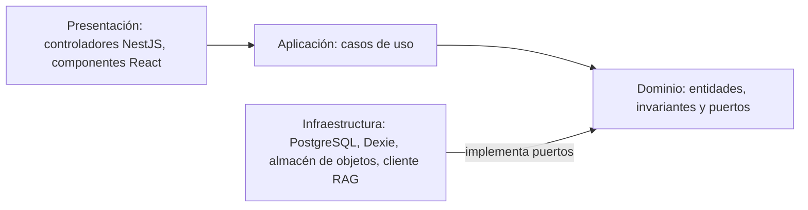

# Enfoque arquitectónico — Clean Architecture pragmática

**Estado:** diseño propuesto (ADR-006).

## 1. Regla de dependencias

Las dependencias del código apuntan hacia el dominio. Las capas internas no conocen frameworks ni tecnologías externas.

| Capa | Responsabilidad | Ejemplos en SIJASS |
|---|---|---|
| Presentación | Transporte HTTP o UI, validación sintáctica, traducción a DTO | `MedicionesController`, formulario React de medición |
| Aplicación | Orquestar casos de uso, autorización, transacciones | `RegistrarMedicion`, `CorregirMedicion`, `SincronizarLote`, `ResponderConsulta` |
| Dominio | Entidades, invariantes y puertos, sin NestJS, React, SQL ni LLM | `Medicion`, `Pago`, `OperacionSync`, `RepositorioMediciones` |
| Infraestructura | Implementación concreta de los puertos | `RepositorioMedicionesPostgres`, `ColaDexie`, `AsistenteRagHttp` |

## 2. Aplicación en cada contenedor

- **API NestJS:** cada módulo del monolito contiene sus cuatro capas. Los módulos se comunican mediante servicios de aplicación, nunca accediendo a las tablas de otro módulo.
- **PWA React:** la lógica de cola y sincronización se aísla de los componentes visuales mediante un puerto de almacenamiento local, lo que permite sustituir Dexie por el almacenamiento de un futuro cliente móvil.
- **Servicio RAG:** sus adaptadores (extractor de PDF, generador de embeddings, índice y proveedor de LLM) se intercambian sin modificar el flujo de consulta.

## 3. Aspectos transversales

- **Seguridad:** la verificación de JASS y privilegios se ejecuta en el servidor aunque el frontend ya haya ocultado la acción.
- **RAG:** el módulo de mediciones no depende del asistente; la consulta documental se realiza mediante un puerto de aplicación y ninguna respuesta generativa altera datos transaccionales.
- **Clientes futuros:** la API OpenAPI permite sustituir o complementar la interfaz web; no se asume que JSX, CSS o bibliotecas web migren directamente a Flutter o React Native.
- **Pragmatismo:** los módulos de configuración simple pueden reducir capas, siempre que el dominio siga libre de dependencias de framework.

## 4. Estado actual del repositorio

`tecnologia/siJASS-clean-architecture/` demuestra la regla de dependencias con una entidad, un caso de uso, dos puertos y repositorios en memoria. Sus campos corresponden al diseño anterior (estimación por IA) y deben migrarse al modelo de registro manual; no contiene API, PWA ni servicio de IA. Ver la [descripción del prototipo](../../tecnologia/siJASS-clean-architecture/README.md).
