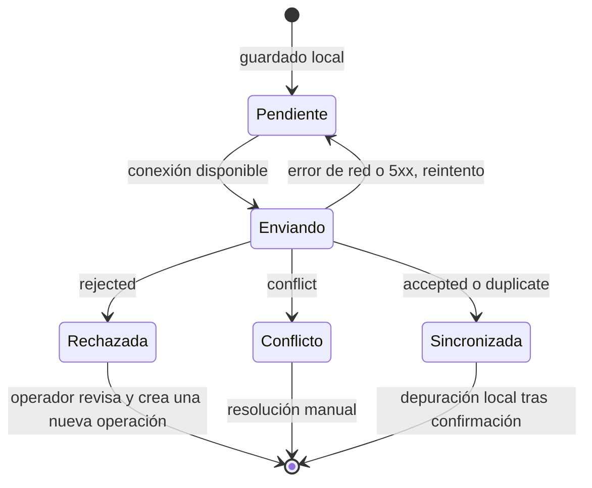
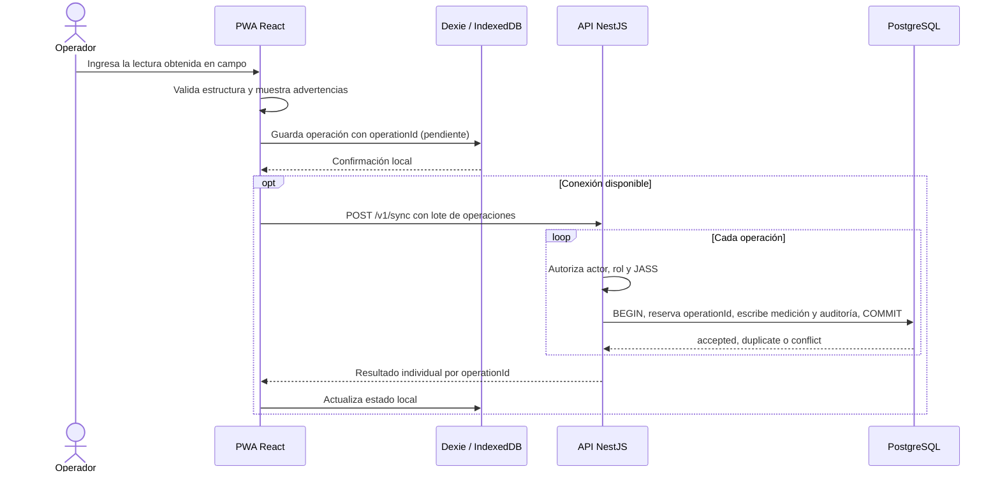

# Diseño interno de módulos — SIJASS

**Estado:** diseño propuesto para el MVP. El prototipo TypeScript actual **no** implementa este diseño; ver [deuda técnica](../../00-alcance-y-roadmap.md#6-deuda-técnica-conocida).

## 1. Módulos del monolito

| Módulo NestJS | Responsabilidad | Requisitos | Datos propios |
|---|---|---|---|
| `identidad` | Autenticación, sesiones, roles y membresías | RF01 | `usuario`, `membresia`, `sesion` |
| `organizacion` | JASS, localidades y reservorios | RF02 | `jass`, `reservorio` |
| `padron` | Asociados, cuotas, pagos, reversas y morosidad | RF03–RF05 | `asociado`, `cuota`, `pago`, `reversa_pago` |
| `mediciones` | Registro, corrección, anulación, historial y reportes | RF06–RF08, RF11, RF15 | `medicion`, `revision_medicion`, `evidencia` |
| `sincronizacion` | Procesamiento idempotente de lotes offline | RF10 | `operacion_idempotente` |
| `documentos` | Catálogo, versiones y aprobación del corpus | RF09, RF14 | `documento`, `version_documento` |
| `asistente` | Consulta al servicio RAG y registro de consultas | RF13 | `consulta_asistente` |
| `auditoria` | Bitácora de eventos sensibles (transversal) | RF08, RF11 | `evento_auditoria` |

Un módulo no lee ni escribe tablas de otro; se coordina mediante servicios de aplicación. `sincronizacion` invoca los casos de uso de `mediciones` dentro de su propia unidad de trabajo.

## 2. Identidad y pertenencia a JASS

- **Entidades:** `Usuario`, `Jass`, `Membresia(usuarioId, jassId, rol, estado)`, `Reservorio`.
- **Casos de uso:** `AutenticarUsuario`, `RenovarSesion`, `AsignarRol`, `DesactivarMembresia`, `ConsultarPermisos`.
- **Invariantes:** la membresía activa y el permiso sobre el recurso se comprueban en cada caso de uso; un identificador enviado por el cliente no concede acceso.
- **Seguridad:** contraseñas con función de derivación robusta; token de acceso de corta duración; limitación de intentos de inicio de sesión; auditoría de cambios de permisos y accesos denegados.

## 3. Asociados, cuotas y pagos

- **Entidades:** `Asociado(id, jassId, estado)`, `Cuota(id, jassId, asociadoId, periodo, importe, estado)`, `Pago(id, jassId, cuotaId, importe, fecha, comprobante, claveIdempotencia)`, `ReversaPago(id, pagoId, motivo, actorId, fecha)`.
- **Casos de uso:** `RegistrarAsociado`, `DarDeBajaAsociado`, `GenerarCuotas`, `RegistrarPago`, `ReversarPago`, `ConsultarMorosidad`.
- **Invariantes:** importes finitos y positivos expresados en céntimos o decimal exacto; la suma de pagos no revertidos no supera el importe de la cuota salvo política explícita; ningún movimiento de dinero se elimina.
- **MVP:** pagos **solo en línea** (ADR-013), con clave de idempotencia enviada en el encabezado `Idempotency-Key`.

## 4. Mediciones de cloro — origen manual

```text
Medicion {
  id: UUID
  jassId: UUID
  reservorioId: UUID
  metodo: CodigoMetodo           // catálogo aprobado (p. ej., comparador DPD, colorímetro)
  valor: decimal                 // lectura realizada por el operador
  unidad: 'mg/L'
  tomadaEn: fecha-hora con zona  // hora de la toma declarada por el operador
  registradaEn: fecha-hora UTC   // hora de recepción en el servidor
  registradoPor: UUID
  origen: 'en-linea' | 'sincronizada'
  evidenciaId?: UUID
  estado: 'vigente' | 'anulada'
  revision: entero               // se incrementa con cada corrección
}

RevisionMedicion {
  medicionId, revision, valorAnterior, valorNuevo,
  motivo, actorId, realizadaEn
}
```

- **Casos de uso:** `RegistrarMedicion`, `CorregirMedicion`, `AnularMedicion`, `ConsultarHistorial`, `GenerarReporte`.
- **Reglas:** valor finito y no negativo; unidad y método del catálogo; `tomadaEn` no posterior a la recepción más una tolerancia configurada; reservorio perteneciente a la JASS del actor. La fotografía nunca sustituye la lectura.
- **Validaciones determinísticas (RF15):** advertencias por valor fuera del rango configurado, toma muy antigua o en el futuro, o posible duplicado (mismo reservorio y hora). Las advertencias no bloquean ni modifican el valor salvo regla explícita.
- **Evidencia:** tipo MIME y tamaño validados, compresión en el cliente, eliminación de metadatos EXIF de ubicación, acceso mediante URL temporal restringida a la JASS, retención definida por política.
- **Desfase con el prototipo:** `src/dominio/medicion.ts` usa `cloroMgL`, `confianza`, `confirmada` y `modeloId` y carece de `jassId`, método y autor; es código heredado del diseño anterior.

## 5. Sincronización de mediciones

### 5.1 Operación offline

```text
OperacionSync {
  operationId: UUID               // generado en el cliente, uno por comando
  tipo: 'registrar-medicion' | 'corregir-medicion'
  payload: objeto                 // comando completo
  payloadHash: SHA-256 del payload canónico
  revisionBase?: entero           // solo para correcciones
  creadaEn: fecha-hora del dispositivo
  estadoLocal: 'pendiente' | 'enviando' | 'sincronizada' | 'rechazada' | 'conflicto'
  intentos: entero
  ultimoError?: texto
}
```

### 5.2 Estados locales



| Resultado del servidor | Significado | Acción del cliente |
|---|---|---|
| `accepted` | Operación aplicada en esta solicitud | Marcar *sincronizada* y guardar el identificador del servidor |
| `duplicate` | La operación ya se había aplicado con el mismo hash | Marcar *sincronizada* con el resultado original |
| `rejected` | Datos inválidos o falta de permiso | Mostrar el motivo; no reintentar automáticamente |
| `conflict` | Mismo `operationId` con distinto hash, o corrección sobre una revisión desactualizada | Mostrar ambas versiones; resolución manual |

### 5.3 Transacción en el servidor

Cada operación del lote se procesa en **su propia transacción**:

1. Verificar sesión, membresía activa y permiso; la JASS se toma del contexto de seguridad.
2. Insertar `(jass_id, operation_id, payload_hash, tipo)` en `operacion_idempotente`, con clave primaria `(jass_id, operation_id)` e `INSERT … ON CONFLICT DO NOTHING`.
3. Si ya existía: comparar hashes y devolver `duplicate` con el resultado almacenado, o `conflict` si difieren.
4. Si es nueva: validar reglas de dominio, escribir la medición o la revisión y el evento de auditoría, y guardar el resultado en la fila de idempotencia.
5. Confirmar la transacción. Ante cualquier error se revierte todo, incluida la reserva del `operationId`, para que un reintento pueda aplicarse.

La respuesta del lote contiene un resultado por `operationId`. Un lote nunca se informa como exitoso en bloque si alguna operación falló.

### 5.4 Reintentos y errores parciales

- La sincronización se dispara al abrir la aplicación, al recuperar la conexión (`online`) y manualmente. No se depende de la API *Background Sync*, que no está disponible en todos los navegadores.
- Reintentos con espera exponencial y variación aleatoria ante errores de red o `5xx`; los errores `4xx` de validación pasan a *rechazada* sin reintento.
- Tamaño de lote acotado (propuesto: hasta 50 operaciones) para limitar el tiempo de cada solicitud.
- Las correcciones se envían después de la medición original de la que dependen.
- El servidor vuelve a autorizar cada operación: la autorización local es provisional.

### 5.5 Límites de la persistencia local

| Límite | Medida de diseño |
|---|---|
| La cuota de almacenamiento por origen depende del navegador y del espacio libre del dispositivo | Consultar `navigator.storage.estimate()` y advertir antes de agotar el espacio; comprimir fotografías y limitar su tamaño |
| El almacenamiento es *best-effort* por defecto y puede desalojarse bajo presión de espacio | Solicitar `navigator.storage.persist()`; sincronizar tan pronto haya conexión |
| El usuario puede borrar los datos del sitio, y la navegación privada no conserva datos | Contador visible de pendientes y advertencia al cerrar sesión con operaciones sin enviar |
| Algunos navegadores eliminan datos de sitios no usados durante un periodo | Sincronización frecuente; definir navegadores soportados en la matriz del piloto |
| IndexedDB no cifra los datos en reposo | Guardar solo lo necesario: catálogo de reservorios y operaciones pendientes; no almacenar el padrón ni pagos |
| El reloj del dispositivo puede estar desfasado | Registrar también la hora de recepción en el servidor y advertir desfases (RF15) |

Referencia: [MDN — Storage quotas and eviction criteria](https://developer.mozilla.org/en-US/docs/Web/API/Storage_API/Storage_quotas_and_eviction_criteria).

### 5.6 Secuencia



## 6. Asistente documental RAG

- **Entidades:** `Documento(id, ambito: publico | jassId, titulo, emisor)`, `VersionDocumento(id, documentoId, version, estado, vigenteDesde, checksum, aprobadoPor)`, `Fragmento(id, versionId, pagina, texto, embedding)`, `ConsultaAsistente(id, actorId, jassId, pregunta, referencias, abstencion, versionPrompt, modelo)`.
- **Casos de uso:** `RegistrarDocumento`, `AprobarVersion`, `SustituirVersion`, `IndexarVersion` (servicio RAG), `ResponderConsulta`.
- **Flujo:** autenticar → determinar ámbitos permitidos (público + JASS del actor) → recuperar fragmentos de versiones aprobadas dentro de esos ámbitos → generar respuesta restringida al contexto → verificar que cada cita corresponda a un fragmento recuperado → devolver respuesta o abstención.
- **Contrato interno NestJS → FastAPI:** la API envía pregunta, `jassId` autorizado e identificador de correlación; el servicio RAG aplica de nuevo el filtro de ámbito (defensa en profundidad).
- **Prohibiciones:** el asistente no crea mediciones, pagos ni alertas, no emite instrucciones de dosificación y no certifica potabilidad.

Detalle completo en la [estrategia de IA](../../06-estrategia-ia/estrategia-ia-sin-dataset.md).

## 7. Auditoría y protección de datos

- `EventoAuditoria(id, jassId, actorId, accion, recurso, recursoId, antes?, despues?, fecha, origen)` se escribe en la misma transacción que el cambio auditado.
- La bitácora es de solo inserción para los roles de la aplicación.
- Datos personales mínimos en el padrón; los registros de consultas al asistente no almacenan datos personales innecesarios.
- Los datos de asociados, pagos y fotografías se tratan conforme a la Ley N.° 29733 y su reglamento; las políticas de retención y consentimiento son decisiones abiertas (ver [roadmap](../../00-alcance-y-roadmap.md#7-decisiones-abiertas)).

## 8. Contratos HTTP objetivo

Rutas ilustrativas, versionadas bajo `/v1`. **No son endpoints publicados**; el contrato definitivo se documentará en OpenAPI con esquemas, errores y ejemplos.

| Ruta | Uso | Regla fundamental |
|---|---|---|
| `POST /v1/auth/login`, `POST /v1/auth/refresh` | Autenticación | Sesión segura y limitación de intentos |
| `GET /v1/reservorios` | Catálogo de la JASS | JASS obtenida de la sesión |
| `GET/POST/PATCH /v1/asociados` | Padrón | Baja lógica; aislamiento por JASS |
| `POST /v1/cuotas`, `POST /v1/pagos`, `POST /v1/pagos/{id}/reversa` | Cuotas y pagos en línea | Transacción y `Idempotency-Key` |
| `POST /v1/mediciones`, `GET /v1/mediciones` | Registro en línea e historial | Trazabilidad y filtros |
| `POST /v1/mediciones/{id}/correcciones` | Corrección | Motivo obligatorio y `revisionBase` |
| `POST /v1/sync` | Lote de operaciones offline | Resultado individual por `operationId` |
| `GET/POST /v1/documentos`, `POST /v1/documentos/{id}/versiones/{v}/aprobacion` | Corpus | Ámbito, versión y aprobación |
| `POST /v1/asistente/consultas` | Asistente RAG | Respuesta citada o abstención |
