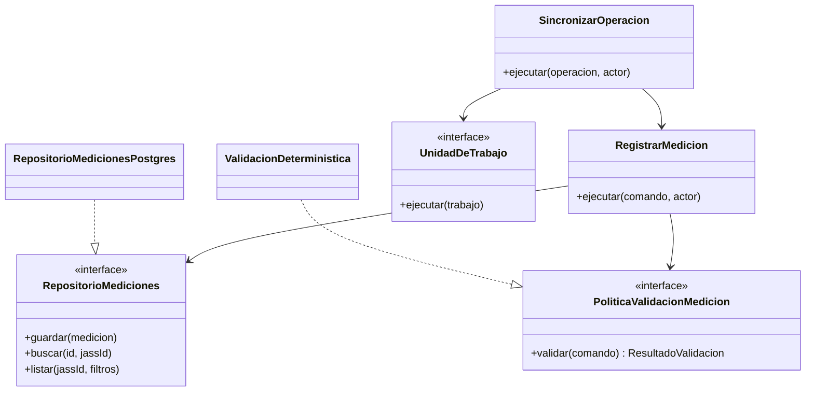

# Patrones de diseño — SIJASS

**Estado:** diseño propuesto. En el prototipo solo existe el patrón Repository con adaptadores en memoria.

## 1. Patrones seleccionados

| Patrón | Aplicación | Problema que resuelve | Estado |
|---|---|---|---|
| Repository | `RepositorioMediciones`, `RepositorioPagos` | Sustituir memoria por PostgreSQL sin cambiar el dominio | Prototipo (memoria) |
| Adapter | `RepositorioMedicionesPostgres`, `ColaDexie`, `AsistenteRagHttp`, `ProveedorLLM` | Aislar dependencias externas detrás de puertos | Diseño propuesto |
| Strategy | `PoliticaValidacionMedicion` | Cambiar reglas determinísticas aprobadas sin reescribir casos de uso | Diseño propuesto |
| Unit of Work | `SincronizarOperacion`, `RegistrarPago` | Persistir idempotencia, efecto de negocio y auditoría en una transacción | Diseño propuesto |
| Specification / Policy | `PoliticaAccesoJass` | Autorización por rol y JASS comprobable con pruebas | Diseño propuesto |
| Facade / Application Service | `ConsultarAsistenteDocumental` | Encapsular autorización → recuperación → generación → verificación de citas | Diseño propuesto |
| Outbox | Notificaciones futuras | No perder eventos tras confirmar una transacción | Futuro, solo si se implementan alertas |

## 2. Criterios de uso

- Un patrón se aplica cuando resuelve un problema concreto de aislamiento, transacción o evolución, no para enumerarlo.
- Un `EstimadorOnnxAdapter` solo podría existir en una etapa de investigación futura; no forma parte del MVP.
- El modelo de lenguaje no es fuente de verdad ni repositorio transaccional; sus respuestas se sustentan en fragmentos recuperados.
- El servicio RAG separado no convierte el resto de los módulos en microservicios.

## 3. Diagrama

