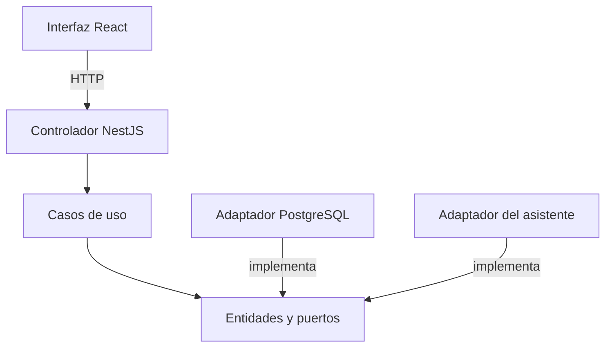

# Principios de diseño SOLID — SIJASS

**Estado:** diseño propuesto; el prototipo demuestra parcialmente DIP y LSP.

## 1. Aplicación de SOLID

| Principio | Aplicación en SIJASS | Antipatrón que se evita |
|---|---|---|
| SRP — Responsabilidad única | Registro de mediciones, autorización y consulta al asistente son responsabilidades separadas | Un controlador que guarda la medición y consulta al LLM en la misma operación |
| OCP — Abierto/cerrado | Nuevas reglas de validación o nuevos adaptadores se agregan implementando un puerto | Modificar la entidad de dominio al cambiar de base de datos o proveedor de IA |
| LSP — Sustitución de Liskov | Los repositorios en memoria y PostgreSQL respetan los mismos resultados y errores del contrato | Un repositorio en memoria que acepta lo que PostgreSQL rechazaría |
| ISP — Segregación de interfaces | Puertos específicos: `RepositorioMediciones`, `BuscadorDocumentos`, `Auditoria`, `ProveedorLLM` | Una interfaz única con decenas de operaciones |
| DIP — Inversión de dependencias | Los casos de uso dependen de contratos, no de NestJS, Dexie, SQL ni del LLM | Importar ORM, FastAPI o React dentro del dominio |

## 2. Ejemplo

`RegistrarMedicion` recibe por constructor la política de validación, el repositorio, la auditoría y la unidad de trabajo. Antes de persistir verifica en el servidor la autorización del actor y la pertenencia del reservorio a su JASS. Cambiar el adaptador de persistencia no modifica las reglas de negocio.

## 3. Evolución hacia clientes móviles

- Si se adopta React Native, podrán compartirse tipos y contratos TypeScript generados desde OpenAPI.
- Un cliente Flutter implementaría los mismos contratos REST en Dart, reescribiendo la interfaz y el almacenamiento local.
- En todos los casos, la capacidad offline exige un adaptador de almacenamiento específico de la plataforma detrás del mismo puerto de cola.

## 4. Estado en el prototipo

`tecnologia/siJASS-clean-architecture/` demuestra DIP (`RegistrarMedicionCasoUso` depende de la interfaz `RepositorioMediciones`) y la sustitución por un adaptador en memoria. Sin embargo, `MedicionesMemoria` lanza un `Error` genérico ante identificadores repetidos, comportamiento que el puerto no especifica (DT06); hasta que el contrato defina ese caso y ambas implementaciones superen la misma batería de pruebas, LSP no está demostrado frente a la futura implementación PostgreSQL.
