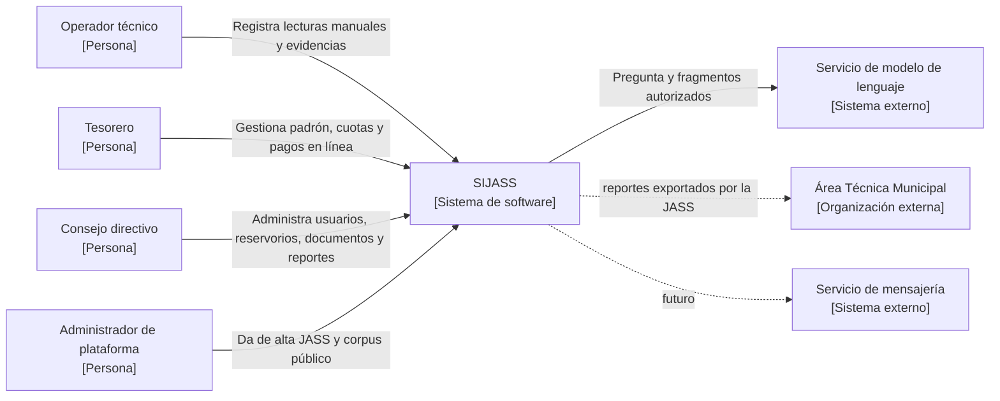

# C4 — Nivel 1: contexto del sistema SIJASS

**Estado:** diseño propuesto; no representa conexiones implementadas.

**Propósito del sistema:** registrar de forma confiable y trazable las mediciones de cloro residual y la administración de las JASS, con operación sin conexión acotada a mediciones y un asistente documental con fuentes verificables.

## Elementos

| Elemento | Tipo | Relación con SIJASS | Alcance |
|---|---|---|---|
| Operador técnico | Persona | Registra lecturas obtenidas en campo, también sin conexión | MVP |
| Tesorero | Persona | Administra asociados, cuotas y pagos en línea | MVP |
| Consejo directivo | Persona | Configura la JASS y supervisa | MVP |
| Administrador de plataforma | Persona | Alta de JASS y curaduría del corpus público | MVP |
| Servicio de modelo de lenguaje | Sistema externo | Genera texto a partir de fragmentos recuperados; puede ser un proveedor por API o un modelo autoalojado | MVP |
| Área Técnica Municipal | Organización externa | Recibe reportes exportados; sin acceso directo | MVP (fuera del sistema) |
| Servicio de mensajería | Sistema externo | Notificaciones | Futuro |

## Límites de responsabilidad

- El operador aporta una lectura obtenida fuera de SIJASS; **no** existe medición automática de cloro por imagen.
- Las respuestas del asistente son orientación documental citada; **no** reemplazan dictámenes técnicos ni validaciones de campo.
- Asociados y ATM no realizan tareas en el sistema durante el MVP.
- El modelo de lenguaje y la mensajería son dependencias externas sin facultades transaccionales.
