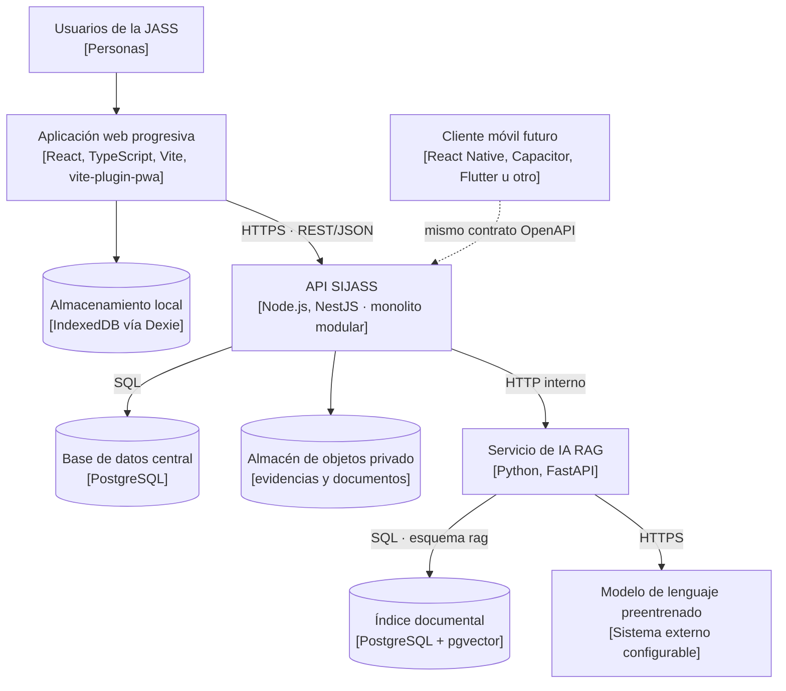

# C4 — Nivel 2: contenedores de SIJASS

**Estado:** diseño propuesto. Ningún contenedor está implementado; el único código existente es el prototipo de dominio descrito en el [nivel 4](Nivel4-Diagrama-de-Codigo.md).

## Contenedores

| Contenedor | Tecnología | Responsabilidad | Sin conexión | Estado |
|---|---|---|---|---|
| Aplicación web progresiva | React + TypeScript + Vite; `vite-plugin-pwa` (Workbox) | Interfaz, registro manual, cola local, administración en línea | Solo registro y corrección de mediciones y catálogos precargados | Diseño propuesto |
| Almacenamiento local | IndexedDB vía Dexie | Operaciones pendientes y catálogo mínimo de reservorios | Sí, dentro de los límites del navegador | Diseño propuesto |
| API SIJASS | Node.js + NestJS, Clean Architecture por módulo | Autenticación, RBAC por JASS, reglas de negocio, sincronización, pagos, auditoría, OpenAPI | No | Diseño propuesto |
| Base de datos central | PostgreSQL | Fuente de verdad transaccional, idempotencia y auditoría | No | Diseño propuesto |
| Almacén de objetos | Compatible con S3 o sistema de archivos con control de acceso | Fotografías de evidencia y PDF del corpus | No | Diseño propuesto |
| Servicio de IA RAG | Python + FastAPI | Ingestión documental, recuperación y generación con citas | No | Diseño propuesto |
| Índice documental | PostgreSQL + pgvector (esquema `rag`) | Fragmentos, metadatos y embeddings | No | Propuesto, sujeto a evaluación (ADR-015) |
| Modelo de lenguaje | Preentrenado, configurable | Redacción de respuestas acotadas a la evidencia | No | Proveedor por decidir |
| Cliente móvil | Por decidir | Mismo contrato de la API | Según plataforma | Futuro |

## Decisiones reflejadas

- La API es el único punto de entrada; el servicio RAG solo es accesible desde ella por red interna (ADR-007).
- El índice documental comparte la instancia PostgreSQL en un esquema separado con un rol de base de datos limitado.
- ONNX Runtime Web no forma parte del MVP: la estimación fotográfica DPD está diferida por falta de dataset (ADR-003).
- Redis no se incluye en el MVP (ADR-009).
