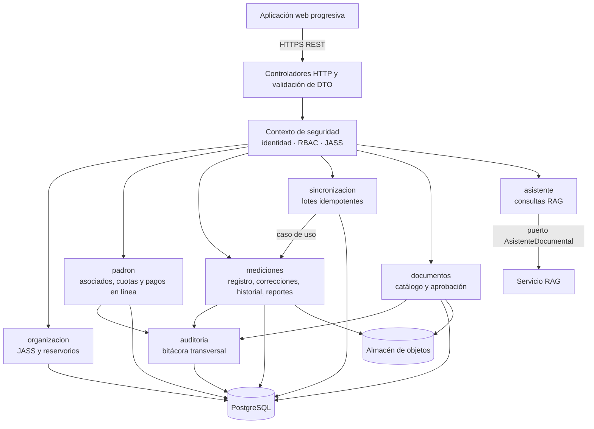
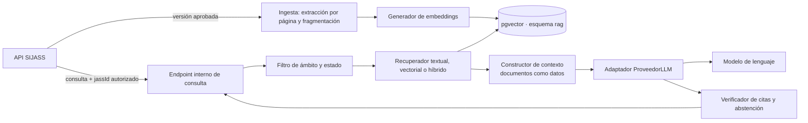

# C4 — Nivel 3: componentes

**Estado:** diseño propuesto; los componentes no corresponden a módulos NestJS ni endpoints publicados.

## 1. API SIJASS (NestJS)

| Componente | Responsabilidad | RF |
|---|---|---|
| Controladores HTTP | Transporte, validación sintáctica, mapeo a comandos; contrato OpenAPI | Todos |
| Contexto de seguridad | Verificar sesión, rol y membresía; inyectar la JASS autorizada en cada caso de uso | RF01 |
| `organizacion` | Catálogo de JASS y reservorios | RF02 |
| `padron` | Asociados, cuotas, pagos con `Idempotency-Key`, reversas y morosidad | RF03–RF05 |
| `mediciones` | Registro manual, validación, correcciones con revisión, historial y reportes | RF06–RF08, RF11, RF15 |
| `sincronizacion` | Lotes offline con idempotencia en la misma transacción que `mediciones` | RF10 |
| `documentos` | Versiones, aprobación y ámbito de los documentos; disparo de indexación | RF09, RF14 |
| `asistente` | Reenvío de consultas autorizadas al servicio RAG y registro de la consulta | RF13 |
| `auditoria` | Eventos de solo inserción en la misma transacción que el cambio | RF08, RF11 |

## 2. Servicio de IA RAG (FastAPI)

| Componente | Responsabilidad |
|---|---|
| Ingesta | Extraer texto por página, fragmentar con metadatos (documento, versión, página) y registrar la versión de indexación |
| Generador de embeddings | Modelo multilingüe validado para español, configurable |
| Filtro de ámbito y estado | Limitar la búsqueda a versiones aprobadas del ámbito público y de la JASS autorizada |
| Recuperador | Búsqueda textual, vectorial o híbrida según la evaluación de ADR-015 |
| Constructor de contexto | Delimitar los fragmentos como datos no confiables e instruir respuesta solo con evidencia |
| Adaptador `ProveedorLLM` | Aislar el proveedor o modelo autoalojado; límites de tokens, tiempo y costo |
| Verificador de citas | Comprobar que cada cita corresponda a un fragmento recuperado; si no hay sustento, devolver abstención |

## 3. Políticas compartidas

- Todo caso de uso obtiene la JASS autorizada del contexto de seguridad del backend.
- La sincronización aplica la idempotencia **en la misma transacción** que la escritura de la medición.
- Cuotas y pagos usan consistencia fuerte y no funcionan sin conexión en el MVP.
- El catálogo filtra permisos **antes** de buscar fragmentos; el servicio RAG repite el filtro.
- El asistente no realiza escrituras ni genera cambios en el tratamiento del agua.
- Los módulos se comunican mediante interfaces de aplicación, nunca accediendo a tablas privadas de otro módulo.
