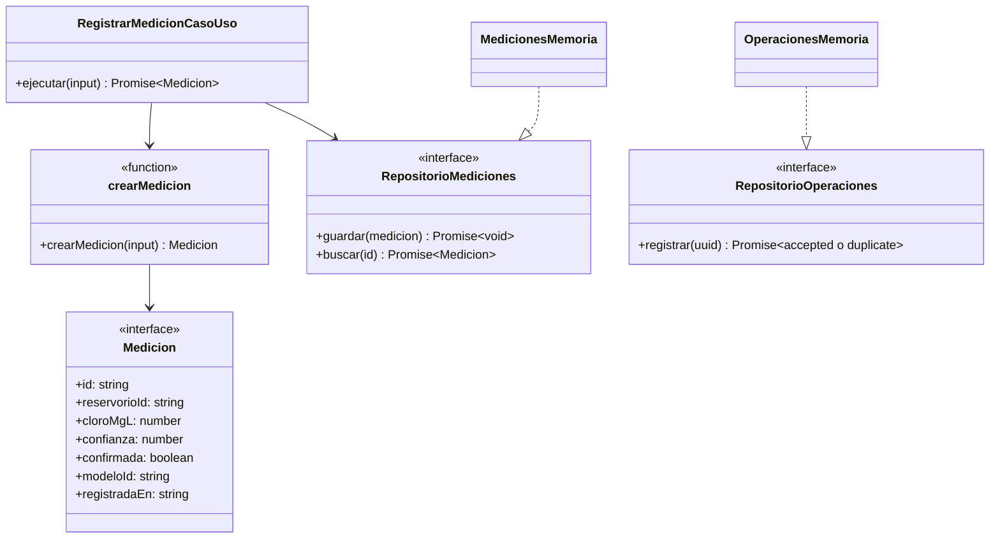
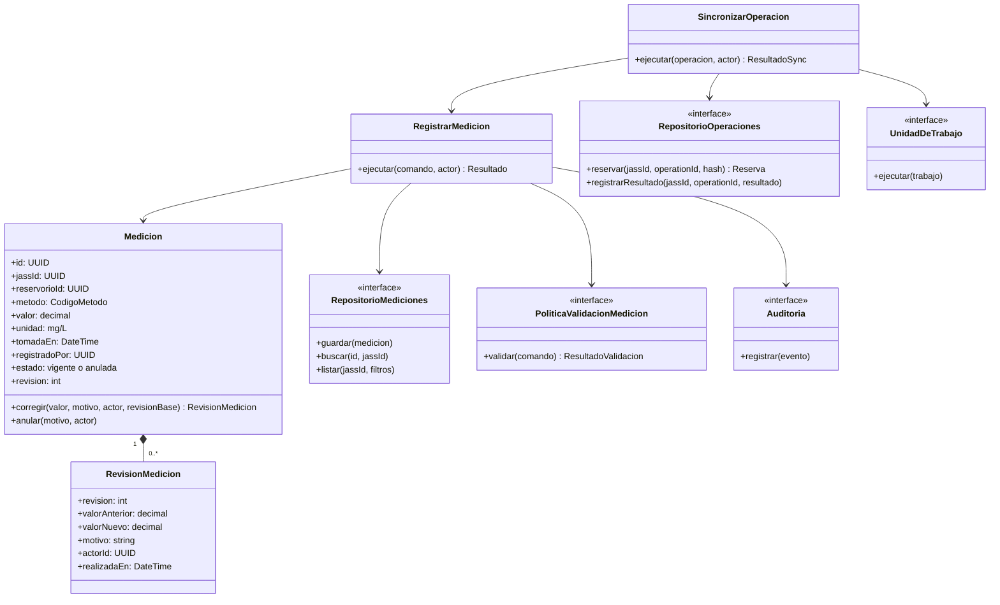

# C4 — Nivel 4: código

Este nivel distingue el **código existente** (prototipo) del **diseño objetivo** para el MVP.

## 1. Código existente — prototipo

**Estado:** prototipo. Ubicación: [`tecnologia/siJASS-clean-architecture/src`](../../tecnologia/siJASS-clean-architecture/README.md).

| Archivo | Contenido |
|---|---|
| `src/dominio/medicion.ts` | Interfaz `Medicion` y función `crearMedicion` que valida identificadores, cloro finito no negativo, confianza en [0, 1] y fecha |
| `src/dominio/puertos.ts` | Puertos `RepositorioMediciones` y `RepositorioOperaciones` |
| `src/aplicacion/registrar-medicion.ts` | `RegistrarMedicionCasoUso`: valida y persiste |
| `src/infraestructura/memoria.ts` | `MedicionesMemoria` (`Map`) y `OperacionesMemoria` (`Set` de UUID con validación de formato) |
| `src/pruebas/dominio.test.ts` | Cinco pruebas unitarias con `node:test` |

**Limitaciones:** el modelo corresponde a la hipótesis anterior de estimación por IA (`confianza`, `modeloId`, `confirmada`); no incluye JASS, método, autor ni revisiones; la idempotencia no es transaccional ni compara contenido; no existen API, persistencia real, autorización ni sincronización. El proyecto no compila en una instalación limpia por falta de `@types/node` (DT01).

## 2. Diseño objetivo del MVP

**Estado:** diseño propuesto; no es código escrito.

## 3. Migración del prototipo al diseño objetivo

1. Validar el contrato objetivo con operadores y la JASS piloto.
2. Corregir la deuda de compilación (DT01, DT02) e incorporar CI.
3. Escribir primero las pruebas de validación, autorización y corrección (PT01, PT02, PT09, PT10).
4. Sustituir los campos heredados mediante un cambio explícito y documentado, sin renombrados silenciosos.
5. Implementar los repositorios PostgreSQL, la unidad de trabajo y la idempotencia transaccional (PT04, PT11, PT12).
6. Aplicar pruebas de contrato y de seguridad antes de habilitar la captura sin conexión.
