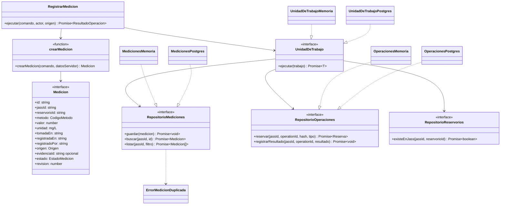
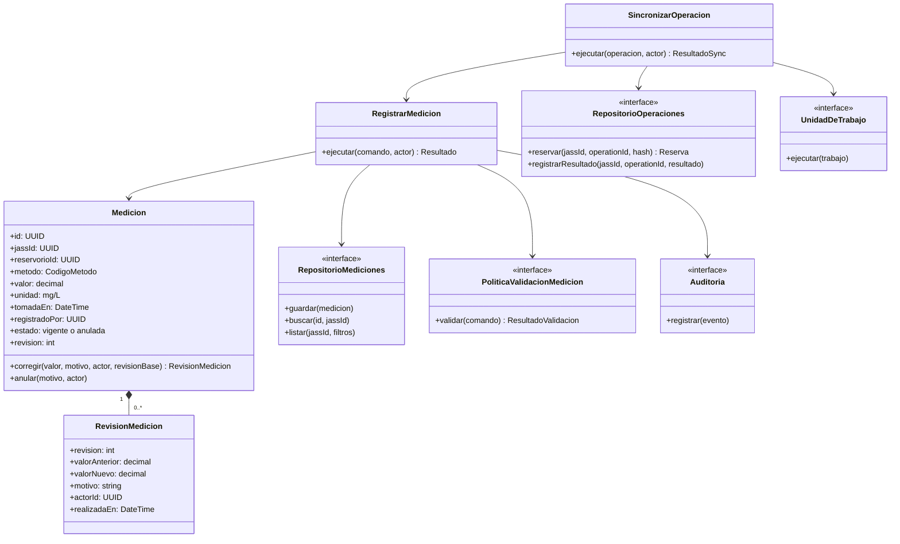

# C4 — Nivel 4: código

Este nivel distingue el **código existente** (prototipo) del **diseño objetivo** para el MVP.

## 1. Código existente — prototipo

**Estado:** prototipo. Ubicación: [`tecnologia/siJASS-clean-architecture/src`](../../tecnologia/siJASS-clean-architecture/README.md). Verificado en CI por `s1a-dominio-medicion` ([PR #5](https://github.com/Henrixfs/SIJASS/pull/5), [ejecución](https://github.com/Henrixfs/SIJASS/actions/runs/43899642952)).

| Archivo | Contenido |
|---|---|
| `src/dominio/medicion.ts` | `Medicion` inmutable y `crearMedicion`: campos permitidos, identificadores, valor finito no negativo, unidad, método, fecha y tolerancia, en un orden fijo |
| `src/dominio/catalogo.ts`, `instante.ts`, `errores.ts` | Catálogo provisional de métodos y unidad `mg/L`; validación estricta de instantes ISO 8601 (UTC); jerarquía `ErrorDominio`, `ErrorValidacion` y `ErrorMedicionDuplicada` |
| `src/dominio/contenido-canonico.ts` | Contenido canónico del comando, base del hash de idempotencia |
| `src/dominio/puertos.ts` | `RepositorioMediciones`, `RepositorioOperaciones`, `RepositorioReservorios`, `UnidadDeTrabajo`, `Reloj` y `GeneradorIds`, con su contrato documentado |
| `src/aplicacion/registrar-medicion.ts` | `RegistrarMedicion`: reserva, validación, escritura y resultado en una sola unidad de trabajo (`accepted`, `duplicate`, `conflict` o `rejected`) |
| `src/infraestructura/memoria.ts` | Implementación en memoria: mutex y copia del estado publicada solo al confirmar |
| `src/infraestructura/postgres/` | Implementación PostgreSQL con `pg`: `INSERT … ON CONFLICT DO NOTHING` en `READ COMMITTED` y `ErrorMedicionDuplicada` ante `medicion_pkey` |
| `migraciones/0001_esquema-mediciones.sql` | Esquema versionado y reversible con las mismas invariantes que el dominio |
| `src/pruebas/` | Pruebas unitarias, baterías de contrato comunes a ambas implementaciones y pruebas de integración contra PostgreSQL |

**Limitaciones:** no implementa `RevisionMedicion` ni correcciones (RF08), advertencias (RF15), auditoría, registro de rechazos, usuarios, API HTTP, autorización, tabla de evidencia ni sincronización por lotes; `SincronizarOperacion` no está separado de `RegistrarMedicion`. El catálogo de métodos es provisional.

## 2. Diseño objetivo del MVP

**Estado:** diseño propuesto; no es código escrito.

## 3. Migración del prototipo al diseño objetivo

1. Validar el contrato objetivo con operadores y la JASS piloto.
2. ~~Corregir la deuda de compilación (DT01, DT02) e incorporar CI.~~ Hecho en el cambio `s0-saneamiento-prototipo` (PR #3, fusionado a `main`).
3. Escribir primero las pruebas de validación, autorización y corrección (PT01, PT02, PT09, PT10).
4. ~~Sustituir los campos heredados mediante un cambio explícito y documentado, sin renombrados silenciosos.~~ Hecho en `s1a-dominio-medicion` ([PR #5](https://github.com/Henrixfs/SIJASS/pull/5)).
5. ~~Implementar los repositorios PostgreSQL, la unidad de trabajo y la idempotencia transaccional (PT04, PT11, PT12).~~ Hecho en `s1a-dominio-medicion` ([CI](https://github.com/Henrixfs/SIJASS/actions/runs/43899642952)); falta separar `SincronizarOperacion` cuando existan lotes y correcciones.
6. Aplicar pruebas de contrato y de seguridad antes de habilitar la captura sin conexión.
