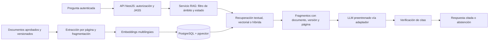

# Estrategia de inteligencia artificial sin dataset propio — SIJASS

**Estado:** diseño propuesto (ADR-003, ADR-007, ADR-012, ADR-014, ADR-015). Ningún componente de IA está implementado.

## 1. Decisión

SIJASS **no dispone** de un dataset validado de fotografías del reactivo DPD con concentraciones de referencia medidas por un instrumento calibrado. Sin ese dataset no es posible entrenar ni evaluar de manera responsable un modelo que estime la concentración de cloro a partir de imágenes.

Por ello, la IA del MVP es un **asistente documental basado en generación aumentada por recuperación (RAG)** que utiliza un modelo de lenguaje **preentrenado** y responde exclusivamente a partir de documentos técnicos aprobados y versionados. El sistema incorpora IA real sin entrenar un modelo propio.

## 2. Registro de mediciones en el MVP

| Aspecto | Decisión |
|---|---|
| Obtención del valor | El operador aplica el procedimiento de medición establecido y lee el resultado |
| Registro | Manual: valor, unidad, método, fecha y hora, reservorio y responsable |
| Fotografía | Evidencia opcional, con acceso restringido y sin metadatos de ubicación; **nunca** se usa para estimar el valor |
| Correcciones | Auditables; conservan el valor original, el motivo, el actor y la fecha |
| Validaciones | Reglas determinísticas versionadas (completitud, formato, rango configurado, coherencia temporal, posibles duplicados); **no** son aprendizaje automático |

## 3. Qué hará y qué no hará el asistente

**Hará:** responder preguntas sobre guías, manuales, procedimientos y normas aprobados para la JASS, citando documento, versión y página, o abstenerse cuando no encuentre evidencia suficiente.

**No hará:**
- estimar concentraciones a partir de imágenes;
- calcular o recomendar dosificación química ni decisiones de tratamiento;
- certificar la potabilidad del agua;
- crear, modificar o eliminar mediciones, pagos u otros registros administrativos;
- obedecer instrucciones contenidas en los documentos.

Las respuestas son **apoyo informativo** y no sustituyen la evaluación del personal competente.

## 4. Arquitectura del RAG

| Elemento | Tecnología | Estado |
|---|---|---|
| Servicio de IA | Python + FastAPI, accesible solo desde la API | Diseño propuesto |
| Índice y metadatos | PostgreSQL + pgvector en esquema `rag` | Sujeto a evaluación frente a búsqueda textual de PostgreSQL (ADR-015) |
| Embeddings | Modelo multilingüe validado para español | Por seleccionar |
| Modelo de lenguaje | Preentrenado, configurable mediante el puerto `ProveedorLLM` (API de un proveedor o modelo autoalojado) | Por seleccionar según privacidad, costo, latencia y calidad en español |

Para un corpus pequeño se evaluará primero si la búsqueda textual o híbrida es suficiente antes de asumir que los embeddings mejoran los resultados.

## 5. Política del corpus

Cada documento conserva:

| Metadato | Finalidad |
|---|---|
| Identificador, título, origen o URL, checksum | Procedencia e integridad del contenido |
| Organismo emisor, fecha y versión | Distinguir versiones y autoría |
| Estado: borrador, aprobado o sustituido | Responder solo con versiones aprobadas |
| Ámbito: público o JASS específica | Evitar fugas entre organizaciones |
| Página o segmento y versión de indexación | Citas reproducibles |
| Responsable y fecha de aprobación | Control humano del corpus |

La [R. M. N.° 568-2026-MINSA](https://www.gob.pe/institucion/minsa/normas-legales/8274822-568-2026-minsa) dispone la publicación de un **proyecto** de reglamento de calidad del agua; no constituye una norma vigente. Un proyecto solo se incorpora al corpus marcado como tal, y la vigencia de toda norma se confirma en la fuente oficial antes de aprobarla.

## 6. Reglas de respuesta y seguridad

1. Autenticar la sesión y filtrar los documentos permitidos **antes** de recuperar fragmentos; el servicio RAG repite el filtro.
2. Tratar el texto de los documentos como **datos**, delimitado en el contexto, nunca como órdenes.
3. Responder solo con el contexto recuperado, sin inventar límites, valores ni normas.
4. Adjuntar citas de documento, versión y página, enlazadas a la versión aprobada.
5. Sin sustento suficiente, responder: «No encontré información verificable en los documentos autorizados» y recomendar consultar a personal competente.
6. No otorgar al modelo herramientas de escritura ni acceso a las bases de datos administrativas.
7. No enviar datos personales, fotografías ni comprobantes al proveedor del modelo.
8. Limitar frecuencia, longitud y costo de las consultas; registrar una auditoría minimizada.

Las mitigaciones siguen las categorías del [OWASP Top 10 for LLM Applications 2025](https://genai.owasp.org/resource/owasp-top-10-for-llm-applications-2025/), en particular la inyección de instrucciones, la divulgación de información sensible, las debilidades de vectores y embeddings, y la agencia excesiva.

## 7. Funcionamiento sin conexión

En el MVP el asistente **requiere conexión**. Sin red, la interfaz informa que no está disponible y el registro de mediciones, el historial local y los catálogos precargados siguen operando. Nunca se presenta una respuesta sin fuentes como si proviniera del corpus. Una biblioteca documental descargable para consulta sin conexión (sin generación) podrá evaluarse en etapas posteriores.

## 8. Evolución por etapas

| Etapa | Capacidad | Requisitos previos | Estado |
|---|---|---|---|
| MVP | Asistente RAG documental | Corpus aprobado, permisos y evaluación de citas y abstención | Diseño propuesto |
| MVP | Validaciones determinísticas | Reglas revisadas y versionadas (no son aprendizaje automático) | Diseño propuesto |
| Futuro 1 | Detección estadística de anomalías | Historial suficiente, limpio y con procedencia; tasa de falsos positivos evaluada | Futuro |
| Futuro 2 | Análisis predictivo de tendencias | Series temporales validadas y evaluación prospectiva | Futuro |
| Investigación | Reconocimiento y estimación fotográfica DPD | Dataset propio representativo, instrumento de referencia, calibración, protocolo de campo y validación independiente | Futuro condicionado |

### Condiciones para investigar la estimación fotográfica

- Dataset recolectado con los teléfonos, iluminaciones, reactivos y comparadores realmente usados por las JASS, con autorización de los participantes.
- Valor de referencia por muestra obtenido con un instrumento calibrado.
- Partición de evaluación independiente y métricas de error definidas antes del entrenamiento.
- Capacidad del modelo de abstenerse ante imágenes de baja calidad.
- Revisión por personal competente antes de cualquier uso operativo, que en ningún caso sustituiría la lectura validada.

## 9. Criterios de aceptación del asistente

Con un conjunto de preguntas revisado (respondibles y no respondibles) se medirá: calidad de la recuperación, exactitud de las citas, afirmaciones sustentadas, abstención correcta, aislamiento entre JASS, resiliencia ante la caída del proveedor y resistencia a instrucciones adversariales (PT15–PT17, PT20). Se versionan prompts, configuración, documentos y modelo para garantizar reproducibilidad.

## 10. Comunicación académica

El RAG se presenta como **capacidad proyectada** mientras no exista implementación y pruebas. No se describe como modelo propio entrenado ni se le atribuye capacidad de validación sanitaria. Véanse las [decisiones arquitectónicas](../01-analisis-de-sistema/07-decisiones-arquitectonicas.md) y la [matriz de trazabilidad](../05-trazabilidad-y-validacion/matriz-trazabilidad.md).

## Referencias

- Lewis, P. et al. (2020). *Retrieval-Augmented Generation for Knowledge-Intensive NLP Tasks*. NeurIPS 2020. https://arxiv.org/abs/2005.11401
- OWASP Foundation. (2024). *OWASP Top 10 for LLM Applications 2025*. https://genai.owasp.org/resource/owasp-top-10-for-llm-applications-2025/
- pgvector: extensión de búsqueda vectorial para PostgreSQL. https://github.com/pgvector/pgvector
